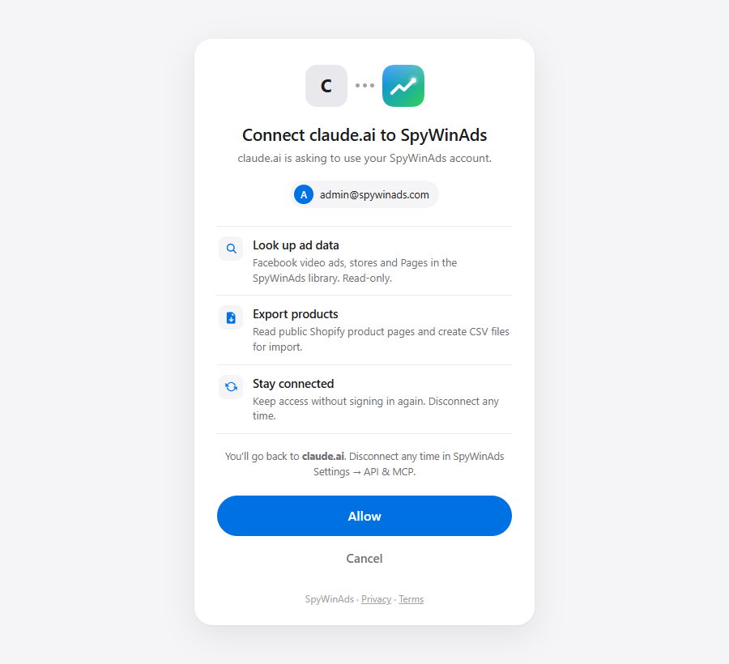

<p align="center"></p>

# SpyWinAds MCP server

Check Facebook video ads from ChatGPT, Claude, Cursor or your own scripts: how old a video ad really is, and every store running the same video.

- **Remote server:** `https://spywinads.com/mcp` (Streamable HTTP)
- **Auth:** OAuth 2.1 (sign in with your SpyWinAds account), or an API key in the `Authorization` header
- **Read-only.** 5 tools. Free plan: 30 calls a day.
- Docs: [spywinads.com/developers](https://spywinads.com/developers)

This repository only documents the hosted server. There is nothing to install.

## Tools

| Tool | Input | Returns |
|---|---|---|
| `spywin_lookup_video_ad` | Meta Ad Library link or ad ID | When the video file was first uploaded to Facebook (within 1–2 days), first ad date, live ads, stores running the same video now and ever, earliest stores in the library |
| `spywin_spy_store_ads` | Store domain | Live ads, new ads in 7 days, videos, products, Pages, top videos with real age and store count |
| `spywin_get_page_ads` | Facebook Page link or ID | Ads and live ads, videos, top videos, stores the Page sends traffic to |
| `spywin_export_shopify_product` | Shopify product URL | Title, prices, variants, images, a Shopify-import CSV link (24 hours), the product's video ads in the library |
| `spywin_get_video_reuse_research` | — | Headline numbers of the SpyWinAds Video Reuse Index, with method and data links. No sign-in needed |

All tools are annotated `readOnlyHint: true`, `destructiveHint: false`. Scopes: `ads:read` (look-ups) and `product:export` (CSV).

## Connect

**ChatGPT** — open **Plugins** in the left sidebar → **More** (top right) → **Add custom MCP server** → paste `https://spywinads.com/mcp`. When a tool needs your account, ChatGPT asks you to sign in to SpyWinAds and click Allow.

**Claude.ai / Claude Desktop** — Customize → Connectors → Add custom connector → paste `https://spywinads.com/mcp` → choose **Sign in when needed**.

**Claude Code**

```bash
claude mcp add --transport http spywinads https://spywinads.com/mcp
# then run /mcp inside Claude Code to sign in
```

**Cursor / VS Code / Windsurf** (API key from SpyWinAds Settings → API & MCP)

```json
{
  "mcpServers": {
    "spywinads": {
      "url": "https://spywinads.com/mcp",
      "headers": { "Authorization": "Bearer YOUR_KEY" }
    }
  }
}
```

Never put a key in a URL. Keys and connected apps can be revoked any time in SpyWinAds Settings → API & MCP.

<p align="center"></p>

## Example prompts

- "Is this video ad new or an old video brought back? https://www.facebook.com/ads/library/?id=1014622548199238"
- "What Facebook video ads is zenblux.com running, and how many other stores use the same videos?"
- "Copy this Shopify product into a CSV I can import: https://www.allbirds.com/products/mens-tree-runners"

## REST API

Same tools over HTTPS for scripts, n8n and GPT Actions:

```bash
curl -H "Authorization: Bearer YOUR_KEY" "https://spywinads.com/api/v1/store?domain=example.com"
```

Endpoints: `/api/v1/video?ad=` · `/api/v1/store?domain=` · `/api/v1/page?page=` · `/api/v1/product?url=` · `/api/v1/research/video-reuse`.
OpenAPI: `https://spywinads.com/api/v1/openapi.json`. Errors are `application/problem+json` (RFC 9457); limits come back in `RateLimit` / `Retry-After` headers.

## Data and limits

- Meta (Facebook, Instagram) ads shown in the US, from the SpyWinAds library (ads scanned by SpyWinAds users).
- Counts are minimums of ads observed, not sales. No ad spend, reach, orders or revenue data.
- "Earliest store" means earliest in the library, not the verified owner of the video.
- Each call returns what the free SpyWinAds web tools show; there is no search across the whole library.
- Limits: free 30 calls a day (resets 00:00 UTC+7), 20 calls a minute.

## Security and privacy

- OAuth 2.1 with PKCE (S256), protected resource metadata (RFC 9728) at `/.well-known/oauth-protected-resource/mcp`, authorization server metadata (RFC 8414), dynamic client registration and client ID metadata documents. Access tokens last 1 hour; refresh tokens rotate.
- Tokens and keys are stored only as SHA-256 hashes. Tokens are bound to `https://spywinads.com/mcp`.
- We log the tool name, success or error and the calling app, not your prompts. Privacy policy: [spywinads.com/privacy](https://spywinads.com/privacy).

## Support

support@spywinads.com · ATT ECOMMERCE COMPANY LIMITED, Hanoi, Vietnam
